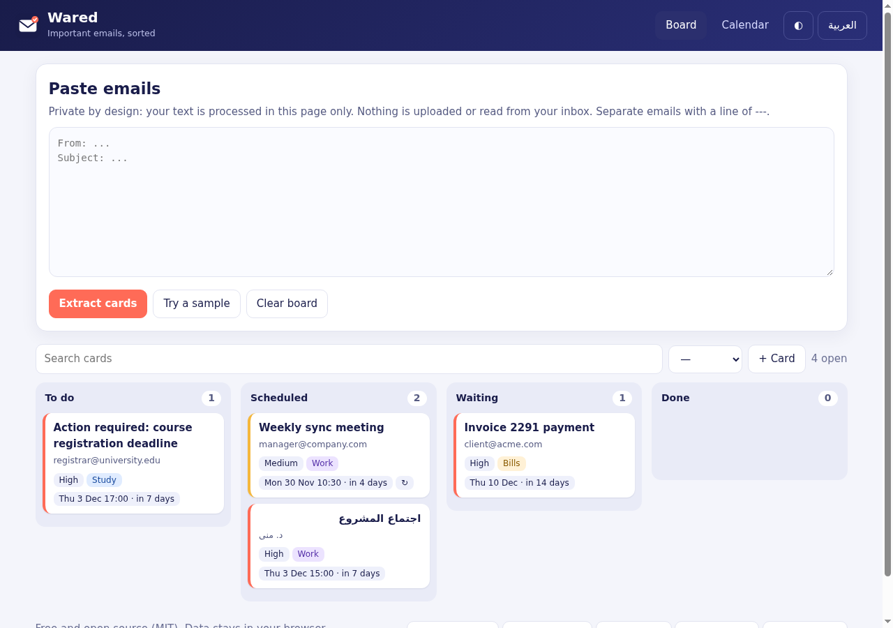
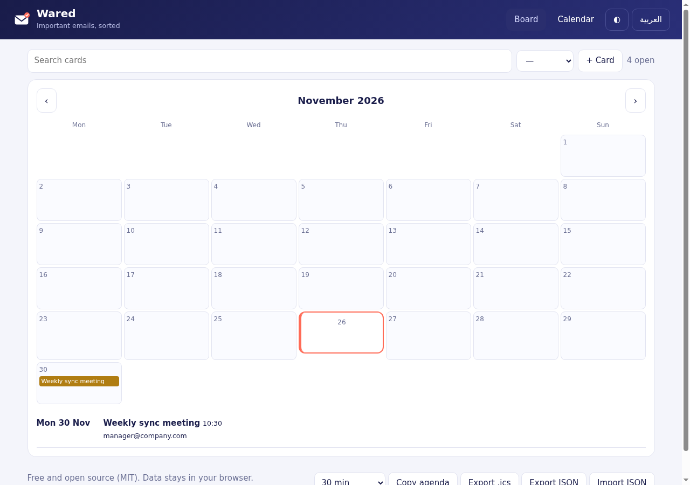
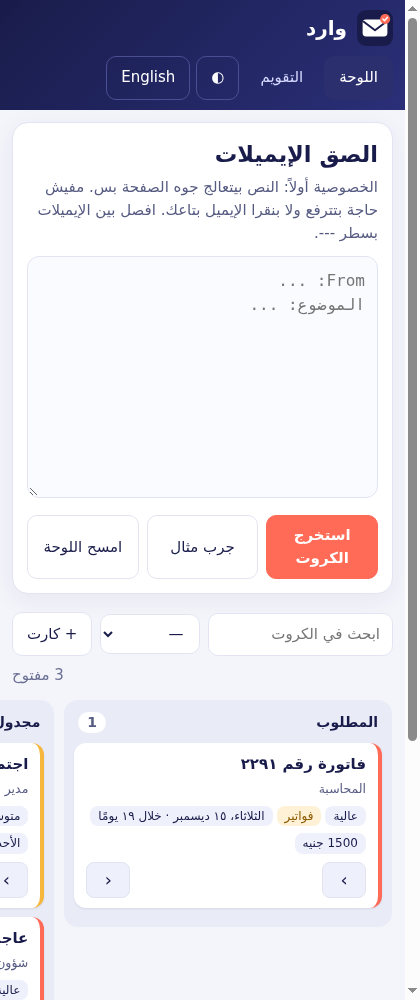
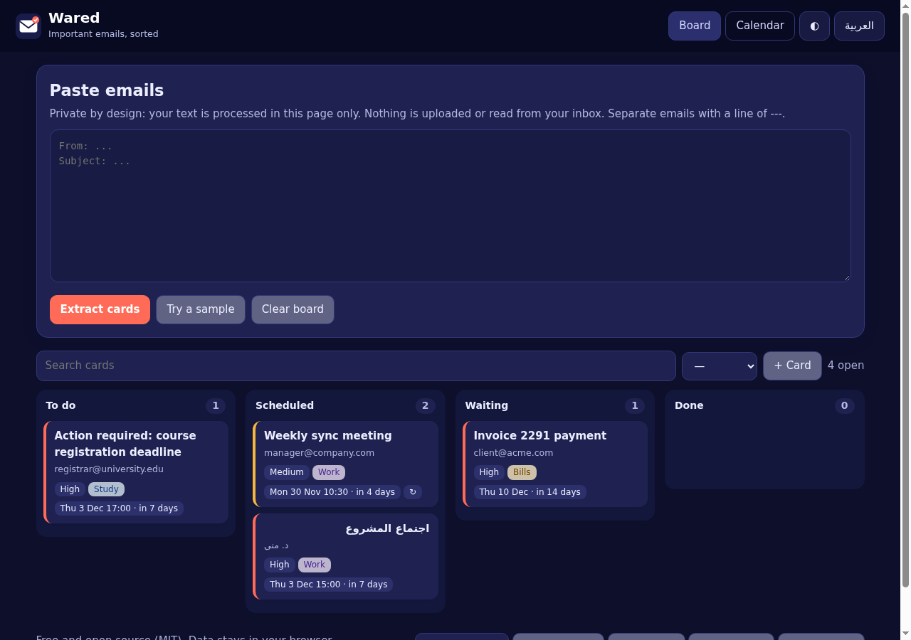

# Wared (وارد)

**Paste your emails. Get kanban cards and calendar items. Nothing leaves your browser.**

[**Live demo**](https://yousefkhames.github.io/wared/) · English and Arabic (RTL) · Free · MIT



| Calendar | Arabic on mobile | Dark mode |
|---|---|---|
|  |  |  |

## What it does
Wared reads pasted email text, finds what matters (deadlines, meetings, invoices, requests), ranks it, drops newsletters, and builds a board plus calendar entries you can import anywhere. You review every card before it is added.

## Features
- Drag-and-drop kanban: To do, Scheduled, Waiting, Done (move buttons on touch and keyboard)
- Understands dates and times in English and Arabic: `3 December 2026`, `Dec 3`, `tomorrow`, `next week`, `end of month`, `2 to 3 pm`, `الساعة ٣:٣٠ م`, `١٥ ديسمبر`, `بعد بكرة`
- Uses the email's own Date header as the reference for "tomorrow" and weekdays, strips quoted replies
- Detects meeting links (Zoom, Meet, Teams), locations and amounts
- Priority scoring, noise filter, duplicate skipping, sender names
- Month calendar, per-card Google Calendar link, `.ics` export with 30-minute alarms
- Auto tags (study, bills, health, work), recurring events (RRULE), a "needs attention" strip, a "why this card" explanation
- Search, priority filter, add by hand, snooze, overdue count, undo, copy agenda as text, JSON import/export, choice of calendar reminder
- Installable offline PWA, dark mode, print view, keyboard shortcuts (`/`, `n`, `c`)
- Accessible: skip link, labels, focus rings, screen-reader announcements, reduced motion

## Privacy
No server, no analytics, no mailbox connection. Parsing runs in the page. Cards are stored in your browser's localStorage. Export or clear them any time.

## Tech stack
Plain HTML, CSS and JavaScript. No framework, no build step, no dependencies. Parser in `docs/parser.js` (also runs in Node for tests). Hosted on GitHub Pages from `docs/`.

## Run it
```bash
git clone https://github.com/yousefkhames/wared
cd wared/docs && python3 -m http.server 8000   # or just open docs/index.html
node test/parser.test.js                        # parser tests
```

Rounds 11 to 38 (each pushed after a real-browser check in English and Arabic, desktop and phone width): Arabic time forms, sender names, duplicate skipping, urgency sorting, relative due labels, clear-done with undo, shortcuts, print view, proper .ics folding, more date phrases, Outlook and forwarded-mail handling, tags, snooze, recurring events, needs-attention strip, draft autosave, explanations, copy agenda, resilient storage, performance and edge-case tests, accessibility focus handling, hand-added cards, reminder choice, tab title count, and phone layout fixes.

## Honest limits
It uses rules, not an AI model, so unusual phrasing can be missed. That is why every card goes through a review step. There is no inbox sync: that would need a Gmail OAuth app and your explicit consent, and it is not built. Dates without a year assume the nearest upcoming one.

## Improvement log (10 rounds)
1. Parser: Arabic months and relative dates, email Date header as reference, time ranges, links, location, amounts, quoted replies stripped, calendar alarms
2. Accessibility: skip link, labels, focus rings, live announcements, keyboard cards, contrast, reduced motion
3. Mobile: snap-scroll columns, large touch targets, move buttons
4. Design: dark mode, gradient header, shadows, empty state, Arabic font stack
5. Search, priority filter, open/overdue stats, undo delete
6. Month-grid calendar with RTL week start
7. Richer cards, per-card .ics and Google Calendar link
8. Installable offline PWA, safe JSON import
9. Onboarding steps, privacy note, share metadata, Arabic sample
10. QA pass in a real browser, hidden-view bug fixed, more tests

## Research notes (existing tools surveyed)
- page2task (iamsherryshen), NavinColumbia/emailToTaskDev, Kambrian/ai-mail-to-calendar, tonimelisma/email-to-calendar, Email_Task_Agent: mostly AI-based or need Gmail/Thunderbird access and API keys.
- mail2task (EbyJK), EmailManager (rule-based spaCy): Python, rule-based extraction and priority, server side.
- chrono-node: the standard JS date parser, English-centric, so Wared ships its own small parser to handle Arabic dates and digits with zero dependencies.
Gap Wared fills: free, no account, no mailbox access, bilingual Arabic/English, paste-and-review with a kanban board and .ics export. Borrowed ideas: review-before-add (from the AI tools, to avoid wrong auto-created events) and rule-based priority scoring (from mail2task/EmailManager).

## License
MIT
